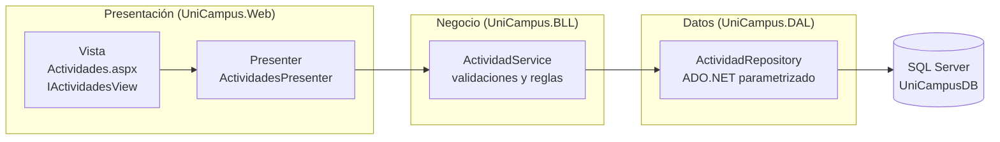

[README.md](https://github.com/user-attachments/files/34687726/README.md)
UniCampus - Registro de actividades académicas

Proyecto parcial y formativo del tercer corte de **Desarrollo de Aplicaciones Web II**

Corporación Universitaria Americana · Docente: Ingeniera Cindy Fuentes

**Primera entrega - 9 de noviembre de 2026 (50%)**

Repositorio: https://github.com/Samuex10/Reto-Actividades-Academicas-DW2

Descripción

El formulario de registro de actividades académicas se transformó en una aplicación web organizada por
responsabilidades: **arquitectura de tres capas** (Presentación, Negocio, Datos) y el patrón
**Model-View-Presenter (MVP)** dentro de la capa de presentación. Esta primera entrega demuestra la arquitectura
con un **flujo completo**: registrar una actividad desde Web Forms hasta SQL Server y listarla.

Integrantes y responsabilidades

Integrante / Responsabilidad 
 Samuel David Camelo Rueda

Tecnologías

- C#
- ASP.NET Web Forms (.NET Framework 4.8)
- SQL Server (LocalDB / Express) con ADO.NET y consultas parametrizadas
- Git y GitHub

Arquitectura

Flujo: `Web Forms -> Presenter (MVP) -> Servicio de negocio -> Repositorio -> SQL Server`

| Proyecto | Capa | Responsabilidad | Contenido |
|---|---|---|---|
| `UniCampus.Web` | Presentación | Interfaz, eventos y resultados | `Actividades.aspx`, `IActividadesView`, `ActividadesPresenter`, `ErrorLog` |
| `UniCampus.BLL` | Negocio | Reglas y validaciones | `ActividadService`, `ResultadoOperacion` |
| `UniCampus.DAL` | Datos | Lectura y escritura en SQL Server | `ActividadRepository`, `BaseDatosInicializador` |
| `UniCampus.Entities` | Compartida | Transporte de datos entre capas | `ActividadDto` |

**Referencias entre proyectos:** Web -> BLL y Entities; BLL -> DAL y Entities; DAL -> Entities.
La capa de datos no depende de la capa Web ni de controles visuales.



MVP

- **Model:** `ActividadDto`, los datos que necesita la vista.
- **View:** la página `Actividades.aspx` y su code-behind, que implementa `IActividadesView`. Solo muestra datos y captura acciones.
- **Presenter:** `ActividadesPresenter` recibe la vista por su interfaz, lee los campos, llama al servicio y le indica a la vista qué mensaje mostrar.

MVP no reemplaza las tres capas: organiza únicamente la capa de presentación.

 Flujo de "Guardar"

1. El usuario completa el formulario y pulsa **Guardar**.
2. Web Forms comunica la acción al Presenter (`Guardar`).
3. El Presenter lee los campos, arma un `ActividadDto` y llama a `ActividadService.Registrar`.
4. El servicio valida (título, fechas, cupo, estado). Si hay errores, devuelve un `ResultadoOperacion` y **no inserta**.
5. Si es válido, el servicio pide al repositorio guardar.
6. El repositorio ejecuta un `INSERT` parametrizado y devuelve el Id generado.
7. El Presenter indica a la vista el mensaje de éxito o error y recarga el listado.

## Estructura del repositorio

```
UniCampus/
├── UniCampus.sln
├── UniCampus.Web/        Presentación (Web Forms + MVP)
├── UniCampus.BLL/        Negocio
├── UniCampus.DAL/        Datos (ADO.NET)
├── UniCampus.Entities/   DTO compartidos
├── database/             03_BaseDatos.sql y verificacion.sql
├── docs/                 arquitectura, pruebas y capturas
├── Respaldo_Proyecto_Inicial/   copia del formulario original
└── README.md
```

Base de datos

El script `database/03_BaseDatos.sql` es reproducible: crea la base `UniCampusDB`, las tablas con sus
restricciones y datos de prueba ficticios, y puede ejecutarse varias veces sin duplicar datos.

| Tabla | Uso | Restricciones destacadas |
|---|---|---|
| `ActividadAcademica` | Entidad central | PK, `Cupos >= 0`, `FechaFin >= FechaInicio`, estados permitidos |
| `Usuario` | Organizadores y participantes | PK, correo único |
| `Inscripcion` | Relaciona usuarios y actividades | PK, FK a actividad y usuario, `UNIQUE (ActividadId, UsuarioId)` |
| `Resena` | Valoraciones (entrega final) | PK, FK, `Calificacion BETWEEN 1 AND 5` |

> Modelo basado en la guía funcional del curso. [Completar: indicar si se reutilizaron o ajustaron
> entidades del diagrama entidad-relación del equipo.]

Requisitos

- Visual Studio 2022 o posterior con la carga de trabajo **ASP.NET y desarrollo web**
- .NET Framework 4.8 (o 4.8.1) Developer Pack
- SQL Server LocalDB (incluido con Visual Studio) o SQL Server Express

Configuración y ejecución

1. Abrir `UniCampus.sln` en Visual Studio y compilar (**Ctrl+Shift+B**).
2. Establecer `UniCampus.Web` como proyecto de inicio y pulsar **F5**.
3. Al arrancar, la aplicación crea la base `UniCampusDB`, las tablas y los datos de prueba si no existen.
   También puede ejecutarse a mano el script `database/03_BaseDatos.sql`.
4. La cadena de conexión `UniCampusDb` está en `UniCampus.Web/Web.config` (LocalDB por defecto; hay una
   opción comentada para SQL Server Express). Usa autenticación integrada de Windows: **no contiene contraseñas**.

**Si hay problemas de conexión:** abrir `/Diagnostico.aspx` (solo desde el mismo equipo) o revisar
`UniCampus.Web/App_Data/errores.log`.

Funciones de la primera entrega

- [x] Registrar actividad (flujo completo Web -> Presenter -> Negocio -> Datos -> SQL Server)
- [x] Listar actividades
- [x] Validaciones de servidor (título, fechas, cupo, estado)
- [x] Consultas SQL parametrizadas
- [x] Manejo de errores con mensajes amigables y registro técnico en `errores.log`
- [x] Codificación HTML de los mensajes (prevención de XSS)

Validaciones y seguridad

- Título obligatorio y con longitud máxima; descripción y lugar con longitud máxima.
- Fecha de fin no anterior a la de inicio.
- Cupo entero y mayor que cero.
- Estado dentro de los valores permitidos.
- Las validaciones se hacen **en el servidor** (capa de negocio), no solo en el navegador.
- Consultas con parámetros tipados de ADO.NET; nunca se concatenan entradas del usuario en el SQL.
- Sin credenciales ni cadenas con secretos en el repositorio.


Pruebas

Casos ejecutados sobre `Actividades.aspx`. Las capturas están en `docs/capturas`.
El detalle completo está en [`docs/PRUEBAS.md`](docs/PRUEBAS.md).

| # | Prueba | Acción | Resultado esperado |

| 1 | Válida | Guardar "Taller de Programación Web" completo | Se guarda y aparece en el listado |
| 2 | Obligatorio | Título vacío | "El título es obligatorio."; no inserta |
| 3 | Cupo cero | Cupos = 0 | Se rechaza |
| 4 | Cupo negativo | Cupos = -5 | Se rechaza |
| 5 | Cupo no numérico | Cupos = abc | "El cupo debe ser un número entero." |
| 6 | Fechas | Fin anterior al inicio | Se rechaza |
| 7 | Consulta | `database/verificacion.sql` | La actividad guardada aparece con los datos correctos |
| 8 | Inyección SQL | Título `'; DROP TABLE dbo.Usuario; --` | Se guarda como texto; las tablas siguen existiendo |
| 9 | XSS | Título `<script>alert(1)</script>` | ASP.NET rechaza la entrada o se muestra como texto |

 Pendientes para la entrega final (23 de noviembre de 2026)

- [ ] Consultar detalle de una actividad
- [ ] Actualizar y eliminar/desactivar actividades
- [ ] Búsqueda y filtros (nombre, fecha, tipo, estado)
- [ ] Inscripción con control de cupos en transacción y sin duplicados
- [ ] Reseñas y calificaciones con reglas y validaciones
- [ ] Autenticación y roles (el usuario debe venir de la sesión)
- [ ] Pruebas funcionales de todas las operaciones, informe y README finales
- [ ] Sustentación individual

