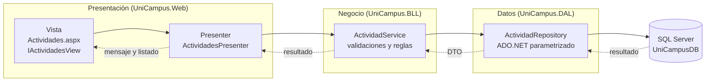

# Diagrama de arquitectura (tres capas + MVP)

Dependencias (hacia adentro): Web -> BLL -> DAL -> SQL Server. `UniCampus.Entities` es referenciado por las tres capas.
Pegar este bloque en https://mermaid.live para exportar la imagen (PNG) y usarla en el informe.
